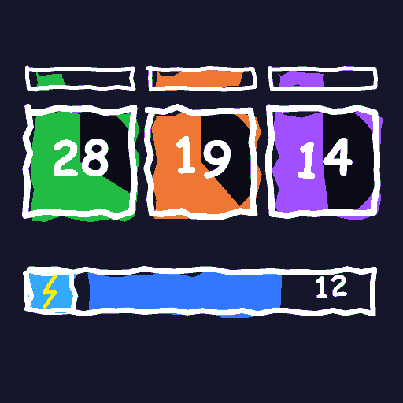
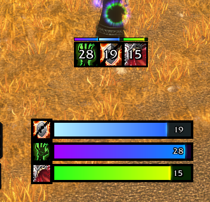
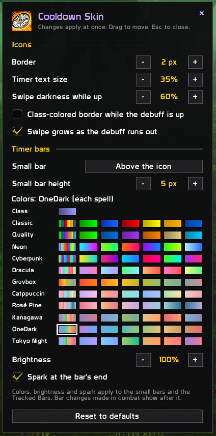

# Cooldown Skin

**WoW: Forever addon:** a cleaner look for the game's Cooldown Manager.

- Square, cropped icons in a black border for Essential, Utility and Tracked Buff icons.
- While your debuff (or buff) is up, the yellow wash is gone: the icon stays bright and a
  dark swipe grows as it runs out. The border stays black, or takes your class color
  with `/cskin highlight`.
- A thin timer bar above the icon while the debuff is up, in gradient colors with a
  spark at its end. Pick them from a color menu: a whole set where each spell gets
  its own pair, one pair for every spell, or your class color. Sets: Classic (the
  game's bar colors), Item quality, Neon, Cyberpunk, Dracula, Gruvbox, Catppuccin,
  Rosé Pine, Kanagawa, OneDark and Tokyo Night. The game client fills the bar
  itself, so it keeps running in combat. It covers your debuffs on an enemy, your
  HoTs and buffs on a friendly target, and buffs on yourself, whichever rank you cast.
- Outlined timer numbers sized to the icon.
- Tracked Bars skinned to match: square icon and bar in black edges, the game's art
  gone, the bar in the same gradient colors with a spark, crisp text.

The Cooldown Manager's layout, spells and Edit Mode settings stay the game's own.
Nothing secret is read: the game client fills the swipe and the timer bar itself.

## Install

Copy this repository's files into a folder named `CooldownSkin` inside
`World of Warcraft\_forever_\Interface\AddOns\`.

## Options

Type `/cskin`, click Cooldown Skin in the minimap addon menu, or go to
Options > AddOns > Cooldown Skin. Every change applies at once.

## Commands

Everything in the window can also be set by command.

| Command | What it does |
| --- | --- |
| `/cskin` | Open the options window |
| `/cskin help` | List the commands |
| `/cskin highlight` | Color the border while the debuff is up (on/off) |
| `/cskin color class` | Bar and highlight in your class color |
| `/cskin color 150 80 230` | A color of your own instead |
| `/cskin border 0-4` | Border thickness in pixels |
| `/cskin bar top \| bottom \| off` | Where the timer bar goes, or none |
| `/cskin barheight 1-12` | Timer bar height in pixels |
| `/cskin barcolor <name>` | Bar colors. A set, each spell its own pair: `classic`, `quality`, `mix` (neon, default), `cyberpunk`, `dracula`, `gruvbox`, `catppuccin`, `rosepine`, `kanagawa`, `onedark`, `tokyonight`. Or `class`, or one pair for all, such as `gruv_red` (names in the color menu's tooltips, lowercase with `_`) |
| `/cskin barglow` | Spark at the bar's end (on/off) |
| `/cskin barbright 0.3-1` | Bar color brightness (default 0.7, 1 = full neon) |
| `/cskin reverse` | Flip which way the debuff swipe runs |
| `/cskin dark 0-1` | Swipe darkness while the debuff is up |
| `/cskin text 0.2-0.8` | Timer number size |
| `/cskin debug` | Show why a timer bar isn't appearing |
| `/cskin reset` | Back to the defaults |

Space between the icons is the game's own setting: in Edit Mode, select the
cooldown row and change its Icon Padding.

## Tested so far

Version 1.0 was tested on a **Warlock** and a low-level **Priest** only:

- Warlock DoTs.
- Priest: Shadow Word: Pain, Power Word: Shield on yourself and on a party member,
  and Renew.

The look should be the same for every class, since it styles the Cooldown Manager's
own icons. The timer bars for other classes' spells are untested. If a spell has no
timer bar while its effect is up, run `/cskin debug` right then and open an issue
with what it prints, your class and the spell.

## Changes

See [CHANGELOG.md](CHANGELOG.md).

## License

MIT, see [LICENSE](LICENSE).
